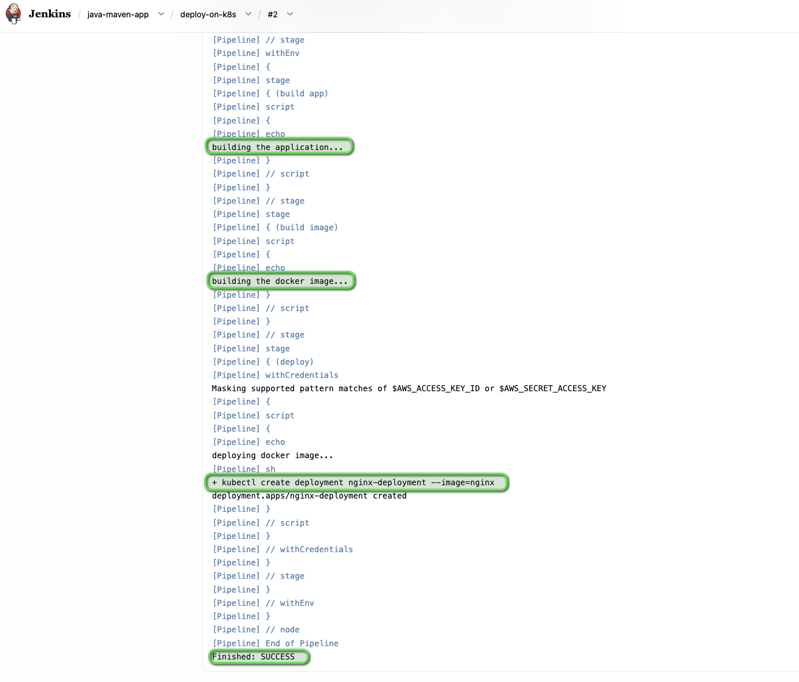
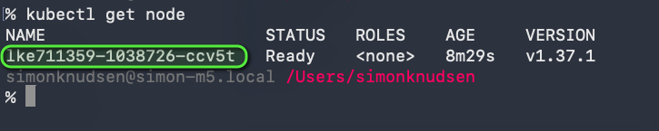
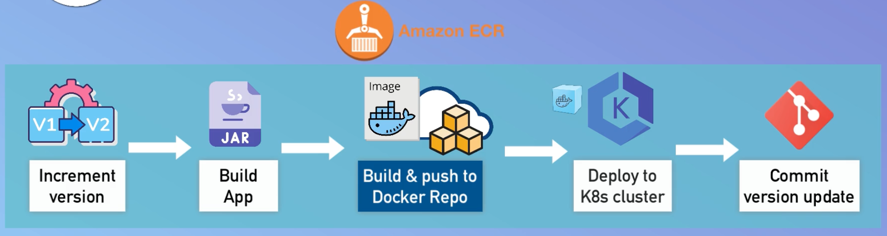
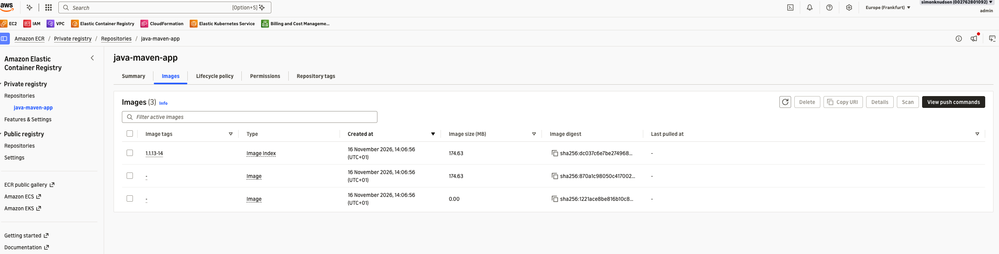
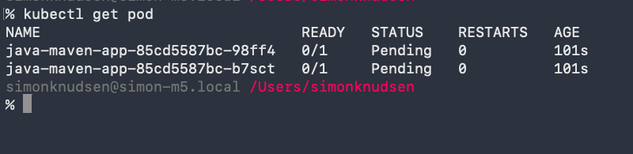

# From Commit to Kubernetes: CI/CD for a Java App with Jenkins, EKS and LKE

**A pipeline that takes a Java application from a Git commit to running pods on managed Kubernetes in about 30 seconds, with no manual steps. I built it in four iterations across AWS and Linode.**

## The problem this solves

Many teams still deploy by hand. Someone builds the app, picks an image tag, runs `kubectl` from their own laptop and hopes nothing was missed. This is slow, it depends on the one person who knows the steps, and when something breaks in production nobody can say for sure which build is running. These four projects replace that process with an automated, traceable pipeline. Each project tackles one part of the problem, and each was a choice between alternatives with real trade-offs.

## Impact at a glance

- **About 30 seconds from commit to running pods.** That covers all five stages (version bump, build, image, deploy, commit back to Git), as shown in the Jenkins stage views below.
- **No manual steps.** Every release is built, packaged, deployed and versioned by the pipeline.
- **Every running pod traces back to its build.** Image tags such as `1.1.13-14` combine the app version with the Jenkins build number.
- **Two cloud providers.** The same deploy pattern was proven on AWS EKS and Linode LKE.
- **Changing registry meant changing configuration, not rewriting the pipeline.** Moving from Docker Hub to AWS ECR meant updating the registry variables, credentials and pull secret, while the pipeline stages stayed the same.
- **No secrets in the code.** AWS keys, registry logins, the kubeconfig and the Git token all live in the Jenkins credentials store.

## Skills at a glance

| Skill area | What I did |
| --- | --- |
| **CI/CD** | Jenkins declarative multibranch pipeline with separate build, image, deploy and release stages |
| **Containers** | Dockerised the Java app, then built and pushed versioned images to private registries (Docker Hub and AWS ECR) |
| **Kubernetes** | Wrote Deployment and Service manifests (2 replicas, port 80 → 8080), pulled from private registries with `imagePullSecrets`, deployed with `kubectl` |
| **Cloud** | AWS EKS, AWS ECR and IAM-based cluster authentication; Linode LKE as a second provider |
| **Release automation** | Automatic semantic version bump, image tags that trace back to the exact build, version change committed back to Git by the pipeline |
| **Security** | Secrets kept in the Jenkins credentials store, injected at runtime and limited to the stages that need them |
| **Infrastructure strategy** | Weighed managed vs. self-managed Kubernetes, portability vs. tighter cloud integration, and simplicity vs. features (`envsubst` vs. Helm) |

## How the projects build on each other

1. **Connect Jenkins to EKS.** Deployments move off people's laptops and into the pipeline.
2. **Do the same on Linode LKE.** This shows the approach isn't tied to one cloud provider.
3. **Build the full pipeline with Docker Hub.** Versioning, building, deploying and releasing all run from a single commit.
4. **Move the registry to AWS ECR.** Images stay inside the AWS account and under IAM.

Projects 2 and 4 pull in opposite directions. Project 2 is about portability, while project 4 deliberately ties the setup more closely to AWS. Both are valid. Which one is right depends on what a business values more, and that is covered in the trade-off sections below.

## Where to find the code

The `master` branch contains the starter application. The pipeline code for each project is on its own branch:

| Project | Branch |
| --- | --- |
| 1. Deploy to EKS | [`deploy-on-k8s`](../../tree/deploy-on-k8s) |
| 2. Deploy to LKE | [`deploy-to-lke`](../../tree/deploy-to-lke) |
| 3 & 4. Full CI/CD with Docker Hub, then with ECR | [`jenkins-jobs`](../../tree/jenkins-jobs) (the ECR version is the latest; the Docker Hub version is in earlier history) |

 

# 1. CD - Deploy to EKS cluster from Jenkins Pipeline

> **Scenario:** A team already builds Docker images in Jenkins, but deploys by hand. One engineer runs `kubectl` from their own laptop using their personal AWS access. Releases wait for that person, and nobody can check what was run.

## The business challenge

When deployments depend on one person's laptop, that person becomes a bottleneck and a single point of failure. There is also no audit trail of what was deployed. The goal was to let the pipeline deploy to a managed Kubernetes cluster without spreading cluster admin access to more people.

## What I built

**Technologies:** Kubernetes, Jenkins, AWS EKS, Docker, Linux

This project extends an existing Jenkins CI/CD pipeline so that the application is deployed to an AWS EKS cluster.

- Installed kubectl and aws-iam-authenticator on the Jenkins server
- Created a kubeconfig file to connect to the EKS cluster and added it to the Jenkins server
- Added AWS credentials to Jenkins for AWS account authentication
- Extended the Jenkinsfile to connect to the EKS cluster and deploy to it

## Why this approach

- **EKS instead of running Kubernetes myself (e.g. kubeadm on EC2):** AWS runs, patches and scales the cluster's control plane, so the team doesn't have to run Kubernetes itself.
- **EKS instead of ECS:** ECS is simpler but only exists on AWS. EKS is standard Kubernetes, so the manifests and skills carry over to any cloud provider (project 2 tests exactly this).
- **IAM authentication (`aws-iam-authenticator`):** access to the cluster is controlled through AWS IAM, so it can be granted and revoked centrally instead of sharing a static cluster token.

## Trade-offs I accepted

- **Cost:** EKS charges a fixed hourly fee for the control plane, on top of the worker nodes. That is worth it for a team, but expensive for a small hobby project.
- **Tools installed by hand on the server:** kubectl and aws-iam-authenticator were installed directly on the Jenkins server. This works, but it isn't written down as code and is easy to get out of sync. Project 2 avoids this.
- **Long-lived AWS keys:** the pipeline uses static access keys from the Jenkins credentials store. That is secure enough to start with, but IAM roles would be better (see [Path to production](#path-to-production)).

## Impact

- Deployments now run from the pipeline, not from someone's laptop, and every one is logged in Jenkins.
- AWS credentials are injected only into the `deploy` stage, never written into the Jenkinsfile.

## Challenges I hit

- **Making sense of Jenkins pipeline logs.** At first the console output was hard to read. Jenkins writes its own messages, shell commands, kubectl output and AWS errors into one long log, so the real error was often buried. I learned to go straight to the stage that failed and find the lines starting with `+`, which show the exact shell command Jenkins ran with the variables filled in. The error usually comes right after. Credentials appear as `****`, which also confirmed they were being injected correctly.

## What I learned

- **Cluster access is an IAM question.** On EKS, the kubeconfig hands authentication to `aws-iam-authenticator`, which turns AWS credentials into a Kubernetes token. Who can deploy is decided in IAM, not in the cluster alone.
- **The CI server is infrastructure too.** Every tool a pipeline needs (kubectl, authenticators, CLIs) has to exist on the Jenkins agent, and someone has to install, update and secure it.
- **Limit secrets to the stage that needs them.** Putting credentials in a stage's `environment` block means they exist only while that stage runs, not for the whole pipeline.

## What I'd do differently

- **Run deploy tools in a container agent** instead of installing them on the Jenkins server, so the tool versions are pinned and recorded in code.
- **Use an IAM role for Jenkins** instead of long-lived access keys, so there are no static secrets to rotate or leak.
- **Give Jenkins least-privilege access in the cluster.** Use a dedicated Kubernetes role that can only deploy to its own namespace, not cluster-admin.

## Screenshots

_All pipeline stages completed successfully, including the deploy to EKS._

 

_Pipeline logs showing the deployment created on the EKS cluster._

 

# 2. CD - Deploy to LKE cluster from Jenkins Pipeline

> **Scenario:** Leadership is worried about rising AWS costs and about being locked into one vendor. Before committing further, they want to know whether the deployment process would still work on a cheaper Kubernetes provider.

## The business challenge

If a deployment process only works on one cloud provider, the business has little bargaining power and expensive moves later on. The question here was whether the pipeline could deploy to a different provider's managed Kubernetes without being rebuilt.

## What I built

**Technologies:** Kubernetes, Jenkins, Linode LKE, Docker, Linux

This project extends the Jenkins CI/CD pipeline so that the application is deployed to a Kubernetes cluster on Linode LKE.

- Created a K8s cluster on LKE
- Installed kubectl as a Jenkins plugin
- Adjusted the Jenkinsfile to use the plugin and deploy to the LKE cluster

## Why this approach

- **Linode LKE as the second provider:** it is managed Kubernetes with a simpler, lower-cost offering. That makes it a realistic alternative to EKS.
- **Kubernetes CLI plugin (`withKubeConfig`) instead of installing tools on the server:** this was a deliberate change from project 1. The plugin loads the kubeconfig only for the deploy step, and nothing has to be installed on the Jenkins server.

## Trade-offs I accepted

- **Plugin dependency:** the pipeline now relies on a Jenkins plugin that has to be kept up to date.
- **Fewer built-in integrations:** LKE has no equivalent to AWS IAM or ECR, so access and registry setup must be handled separately.
- **Simple workload:** the test deploys a plain nginx image. It proves the deploy path works, not full feature parity with EKS.

## Impact

- The same deploy pattern now runs on two cloud providers, which is evidence that the business could move between them.
- Setting up Jenkins is easier to repeat: install a plugin and add a credential, with no work on the server itself.

## What I learned

- **Managed Kubernetes providers differ mostly around the edges.** Workloads and `kubectl` commands are the same everywhere. What changes is authentication, networking and how each provider integrates with its other services.
- **Plugins make setup simpler but add something to maintain.** `withKubeConfig` removed the manual server setup from project 1, but it is one more plugin to keep updated and compatible.
- **Portability has to be protected on purpose.** It only lasts if the pipeline avoids provider-specific shortcuts.

## What I'd do differently

- **Deploy the real application, not nginx,** to prove the whole flow (private registry, manifests, Service) works on the second provider too.
- **Keep the cluster URL and credential IDs out of the Jenkinsfile** and in Jenkins configuration or pipeline parameters, so the same pipeline can target any cluster.
- **Use one deploy approach for both clusters.** A single parameterised pipeline that can target EKS or LKE would make the portability claim concrete.

## Screenshots

_The LKE cluster node is up and in Ready state._

 

_All pipeline stages completed successfully, including the deploy to LKE._

 

_The nginx deployment pod is running on the LKE cluster._

 

# 3. Complete CI/CD Pipeline with EKS and private DockerHub registry

> **Scenario:** Every release involves bumping the version number by hand, choosing an image tag and editing the deployment files. Tags get reused, the version in Git drifts away from what is actually deployed, and when a bug shows up nobody can say which build is in production.

## The business challenge

Without versioning and traceability, rolling back is guesswork and fixing problems takes longer. The goal was a pipeline where **one commit produces one uniquely identified release** that is built, deployed and recorded with no manual steps.

## What I built

**Technologies:** Kubernetes, Jenkins, AWS EKS, Docker Hub, Java, Maven, Linux, Docker, Git

- Wrote K8s manifest files for the Deployment and Service configuration
- Integrated a deploy step in the CI/CD pipeline that deploys the newly built application image from the private DockerHub registry to the EKS cluster
- The complete CI/CD pipeline has the following configuration:
  1. CI step: Increment version
  2. CI step: Build artifact for Java Maven application
  3. CI step: Build and push Docker image to DockerHub
  4. CD step: Deploy new application version to EKS cluster
  5. CD step: Commit the version update

## Why this approach

- **Automatic semantic version plus build number, instead of manual tags or `latest`:** Maven's `build-helper:parse-version` and `versions:set` raise the patch version, and the image is tagged `<version>-<BUILD_NUMBER>` (e.g. `1.1.12-12`). Every tag is unique and links to an exact Jenkins run. With `latest`, you can't tell which build is running.
- **`envsubst` templating instead of Helm or Kustomize:** one manifest with placeholders serves every release. It is the simplest tool that solves the problem, with no extra tools to learn or maintain.
- **Private registry with `imagePullSecrets`:** company images shouldn't be public. The cluster authenticates to pull them.
- **Pipeline commits the version bump back to Git:** the repository stays the source of truth, so the code and the deployed version always match.

## Trade-offs I accepted

- **`envsubst` has no release history.** Unlike Helm, there is no built-in rollback or record of past releases. Rolling back means redeploying an earlier tag by hand.
- **Risk of a build loop:** the pipeline's own `ci: version bump` commit can trigger a new build unless Jenkins is set to ignore it.
- **Docker Hub is outside AWS:** that means separate credentials, pull rate limits, and an external dependency on the critical path.

## Impact

- **About 30 seconds from commit to two running replicas** of the new version (Jenkins stage view, below).
- Every pod links to its build: `kubectl describe pod` shows the exact image tag.
- Version bumps are automatic and the code and the deployed version always match. Nobody tracks releases by hand.

## Challenges I hit

- **Giving Jenkins access to push the version bump to GitHub.** This was the hardest step to get working. Jenkins needed a GitHub personal access token with write access to the repository, stored as a Jenkins credential and used in the Git remote URL. It also needed a Git user name and email set before it could commit at all. And because Jenkins checks out a specific commit rather than a branch, the push has to name the branch explicitly (`git push origin HEAD:jenkins-jobs`).
- **Environment variables across Groovy, the shell and `envsubst`.** The image name is worked out in Groovy (`env.IMAGE_NAME`), used in shell commands, and finally written into the Kubernetes manifests by `envsubst`. Each layer handles variables differently. In a Jenkinsfile, Groovy fills in variables inside double quotes, while single-quoted commands go to the shell unchanged. `envsubst` only sees variables that are exported to the environment. Getting a value to arrive correctly in the deployed manifest meant understanding all three layers.

## What I learned

- **Traceability is what makes automation trustworthy.** A fast pipeline isn't enough. You need to know exactly which build is running in order to debug or roll back with confidence.
- **A pipeline that writes to Git needs guardrails.** Committing the version bump back creates a risk of build loops, and it needs a credential that can write to the repository, which has to be protected.
- **Simple tools are a valid starting point.** `envsubst` solved the templating problem with nothing extra to install, but it helps to know its limits (no release history, no rollback) before relying on it.

## What I'd do differently

- **Ignore the pipeline's own version-bump commits from day one,** so they never trigger a new build.
- **Use Helm once rollback matters,** to get release history and one-command rollbacks instead of redeploying old tags by hand.
- **Make the Deployment production-ready** by adding readiness and liveness probes and CPU/memory requests and limits, so Kubernetes can detect unhealthy pods and schedule them sensibly.
- **Also label images with the Git commit SHA,** so each image links directly to the exact source code as well as the build.

## Screenshots

_All pipeline stages completed successfully: increment version, build app, build image, deploy and commit version update._

 

_The java-maven-app pods created on the EKS cluster by the deploy stage._

 

_The deployed pod uses the newly built image `simonknudsen7/demo-app:1.1.12-12` from the private DockerHub registry._

 

# 4. Complete CI/CD Pipeline with EKS and AWS ECR

> **Scenario:** A security review flags that production images are stored with an outside provider (Docker Hub), under credentials that AWS IAM doesn't control. The team is asked to keep images inside the AWS account, close to the cluster.

## The business challenge

The registry sits on the path to production. If it is outside the cloud account, it brings separate credentials, separate access policies and another outside dependency that can fail. The goal was to move the registry into AWS **without rebuilding the pipeline**.

## What I built

**Technologies:** Kubernetes, Jenkins, AWS EKS, AWS ECR, Java, Maven, Linux, Docker, Git

- Created a private AWS ECR Docker repository
- Adjusted the Jenkinsfile to build and push the Docker image to AWS ECR
- Integrated deploying to the K8s cluster in the CI/CD pipeline from the AWS ECR private registry
- The complete CI/CD pipeline has the following configuration:
  1. CI step: Increment version
  2. CI step: Build artifact for Java Maven application
  3. CI step: Build and push Docker image to AWS ECR
  4. CD step: Deploy new application version to EKS cluster
  5. CD step: Commit the version update

## Why this approach

- **ECR instead of staying on Docker Hub:** IAM controls access to the images, they are stored in the same AWS region as the cluster, and Docker Hub's pull rate limits no longer apply.
- **Configuration, not code:** project 3 had already put the registry in two environment variables (`DOCKER_REPO_SERVER`, `DOCKER_REPO`). The move was a configuration change plus a new pull secret (`aws-registry-key`), and none of the pipeline stages changed.

## Trade-offs I accepted

- **More AWS lock-in.** This goes against the portability shown in project 2. It is a deliberate choice: for a team already committed to EKS, tighter integration is worth more than being able to move. A team that had to stay multi-cloud might reasonably decide the other way.
- **Static ECR credential:** ECR login tokens expire after 12 hours, so a static credential in Jenkins is fragile. Production needs logins generated at build time (see [Path to production](#path-to-production)).

## Impact

- The whole delivery path (code → image → cluster) now runs inside one AWS account, under one access-control system.
- The registry was replaced with **no changes to the pipeline stages**, which shows the earlier design decisions paid off.
- Same results as project 3: about 30 seconds from commit to running pods, and every pod traces back to its build (`java-maven-app:1.1.13-14`).

## Challenges I hit

- **Switching from Docker Hub to ECR.** The pipeline stages stayed the same, but the switch touched more than it first seemed:
  - ECR image names must include the full registry address (`<account>.dkr.ecr.<region>.amazonaws.com/java-maven-app`).
  - `docker login` has to target that registry instead of Docker Hub.
  - Jenkins needed new registry credentials.
  - The cluster needed a new pull secret (`aws-registry-key`).

  If any one of these is wrong, either the image push or the pod start fails, so I had to check each one in turn.

## What I learned

- **Putting settings in variables early pays off later.** Because project 3 kept the registry in environment variables, switching registry was a configuration change, not a rewrite.
- **Registry logins work differently from cloud to cloud.** ECR uses short-lived tokens tied to IAM, unlike Docker Hub's username and password, and that affects how the pipeline should log in.
- **Every infrastructure choice trades portability against integration.** Neither is right in general. It depends on what the business is optimising for.

## What I'd do differently

- **Generate ECR logins at build time** with `aws ecr get-login-password` instead of storing a credential in Jenkins.
- **Let EKS pull images through the node IAM role.** On EKS, worker nodes can pull from ECR using their own IAM permissions, which removes the need for an `imagePullSecrets` secret.
- **Turn on ECR image scanning and lifecycle policies** to catch known vulnerabilities on push and to clean up old images automatically.
- **Create the ECR repository with Terraform,** so the registry is version-controlled alongside the rest of the infrastructure.

## Screenshots

_All pipeline stages completed successfully: increment version, build app, build image, deploy and commit version update._

 

_The newly built image `1.1.13-14` pushed to the private `java-maven-app` repository in AWS ECR._

 

_The java-maven-app pods created on the EKS cluster by the deploy stage._

 

_The deployed pod is configured with the newly built image `java-maven-app:1.1.13-14` from the private AWS ECR registry._

 

# Path to production

These projects focus on building a working pipeline from start to finish. To run this for a real team, I would close the gaps listed in the trade-off sections above:

| Gap | Fix | Why it matters |
| --- | --- | --- |
| Long-lived AWS access keys | IAM roles for the Jenkins server, IRSA for workloads | Credentials that don't expire are the biggest security risk here |
| Static ECR credential | `aws ecr get-login-password` at build time | ECR tokens expire after 12 hours; generating them at build time removes manual rotation |
| `envsubst` has no rollback | Helm chart, deployed through GitOps (e.g. Argo CD) | Release history, one-command rollback, and the cluster kept in sync with Git |
| Clusters and registry created by hand | Terraform for EKS/LKE and ECR | The environment can be rebuilt, reviewed and recreated per stage (dev/staging/prod) |
| Version-bump commit triggers a new build | Configure Jenkins to ignore `ci: version bump` commits | Prevents endless build loops and wasted CI time |
