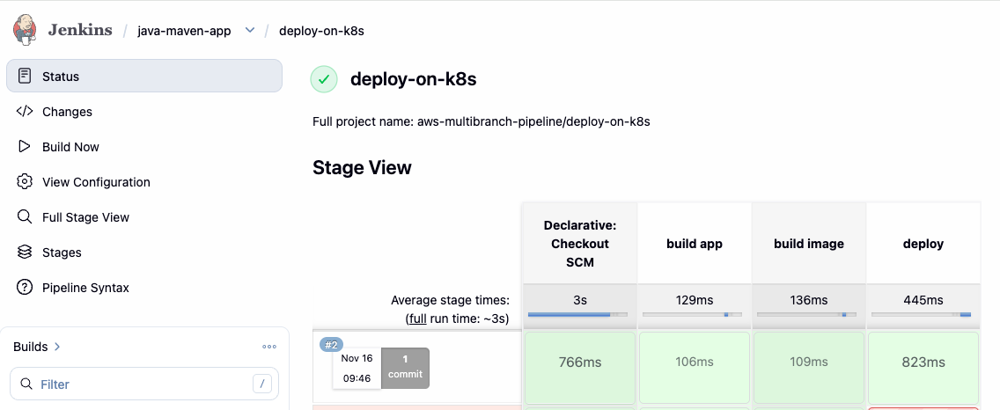
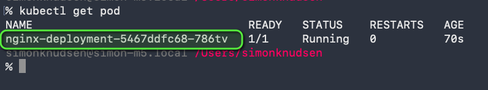

# CD - Deploy to EKS cluster from Jenkins Pipeline

## Technologies used

Kubernetes, Jenkins, AWS EKS, Docker, Linux

## Project Description

This project extends an existing Jenkins CI/CD pipeline so that the application is deployed to an AWS EKS cluster.

- Installed kubectl and aws-iam-authenticator on the Jenkins server
- Created a kubeconfig file to connect to the EKS cluster and added it to the Jenkins server
- Added AWS credentials to Jenkins for AWS account authentication
- Extended the Jenkinsfile to connect to the EKS cluster and deploy to it

## Screenshots

_All pipeline stages completed successfully, including the deploy to EKS._

 

_Pipeline logs showing the deployment created on the EKS cluster._

 

# CD - Deploy to LKE cluster from Jenkins Pipeline

## Technologies used

Kubernetes, Jenkins, Linode LKE, Docker, Linux

## Project Description

This project extends the Jenkins CI/CD pipeline so that the application is deployed to a Kubernetes cluster on Linode LKE.

- Created a K8s cluster on LKE
- Installed kubectl as a Jenkins plugin
- Adjusted the Jenkinsfile to use the plugin and deploy to the LKE cluster

## Screenshots

_The LKE cluster node is up and in Ready state._

 

_All pipeline stages completed successfully, including the deploy to LKE._

 

_The nginx deployment pod is running on the LKE cluster._
