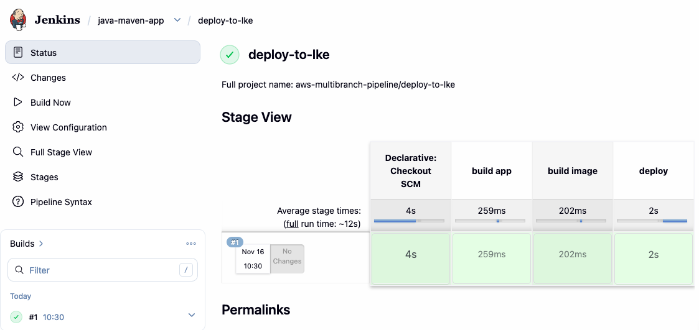
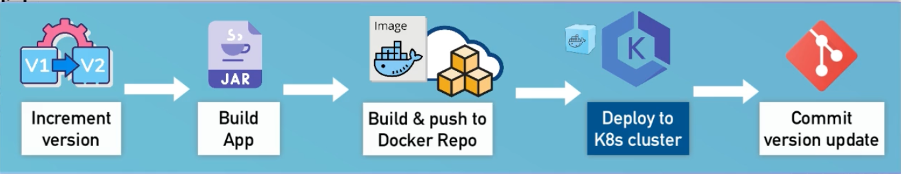
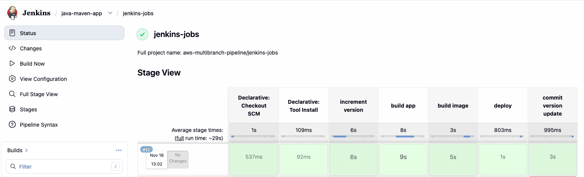
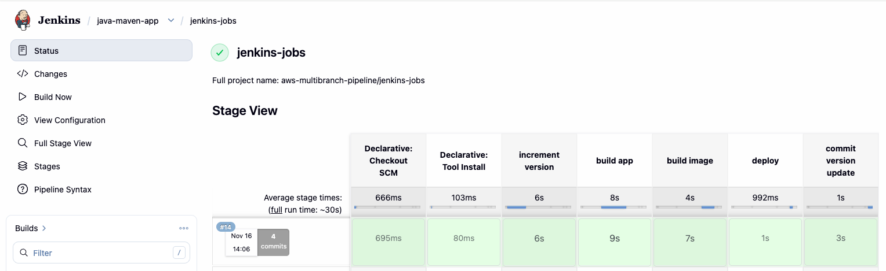

# CD - Deploy to EKS cluster from Jenkins Pipeline

## Technologies used

Kubernetes, Jenkins, AWS EKS, Docker, Linux

## Project Description

This project extends an existing Jenkins CI/CD pipeline so that the application is deployed to an AWS EKS cluster.

- Installed kubectl and aws-iam-authenticator on the Jenkins server
- Created a kubeconfig file to connect to the EKS cluster and added it to the Jenkins server
- Added AWS credentials to Jenkins for AWS account authentication
- Extended the Jenkinsfile to connect to the EKS cluster and deploy to it

## Screenshots

_All pipeline stages completed successfully, including the deploy to EKS._

 

_Pipeline logs showing the deployment created on the EKS cluster._

 

# CD - Deploy to LKE cluster from Jenkins Pipeline

## Technologies used

Kubernetes, Jenkins, Linode LKE, Docker, Linux

## Project Description

This project extends the Jenkins CI/CD pipeline so that the application is deployed to a Kubernetes cluster on Linode LKE.

- Created a K8s cluster on LKE
- Installed kubectl as a Jenkins plugin
- Adjusted the Jenkinsfile to use the plugin and deploy to the LKE cluster

## Screenshots

_The LKE cluster node is up and in Ready state._

 

_All pipeline stages completed successfully, including the deploy to LKE._

 

_The nginx deployment pod is running on the LKE cluster._

 

# Complete CI/CD Pipeline with EKS and private DockerHub registry

## Technologies used

Kubernetes, Jenkins, AWS EKS, Docker Hub, Java, Maven, Linux, Docker, Git

## Project Description

- Wrote K8s manifest files for the Deployment and Service configuration
- Integrated a deploy step in the CI/CD pipeline that deploys the newly built application image from the private DockerHub registry to the EKS cluster
- The complete CI/CD pipeline has the following configuration:
  1. CI step: Increment version
  2. CI step: Build artifact for Java Maven application
  3. CI step: Build and push Docker image to DockerHub
  4. CD step: Deploy new application version to EKS cluster
  5. CD step: Commit the version update

## Screenshots

_All pipeline stages completed successfully: increment version, build app, build image, deploy and commit version update._

 

_The java-maven-app pods created on the EKS cluster by the deploy stage._

 

_The deployed pod uses the newly built image `simonknudsen7/demo-app:1.1.12-12` from the private DockerHub registry._

 

# Complete CI/CD Pipeline with EKS and AWS ECR

## Technologies used

Kubernetes, Jenkins, AWS EKS, AWS ECR, Java, Maven, Linux, Docker, Git

## Project Description

- Created a private AWS ECR Docker repository
- Adjusted the Jenkinsfile to build and push the Docker image to AWS ECR
- Integrated deploying to the K8s cluster in the CI/CD pipeline from the AWS ECR private registry
- The complete CI/CD pipeline has the following configuration:
  1. CI step: Increment version
  2. CI step: Build artifact for Java Maven application
  3. CI step: Build and push Docker image to AWS ECR
  4. CD step: Deploy new application version to EKS cluster
  5. CD step: Commit the version update

## Screenshots

_All pipeline stages completed successfully: increment version, build app, build image, deploy and commit version update._

 

_The newly built image `1.1.13-14` pushed to the private `java-maven-app` repository in AWS ECR._

 

_The java-maven-app pods created on the EKS cluster by the deploy stage._

 

_The deployed pod is configured with the newly built image `java-maven-app:1.1.13-14` from the private AWS ECR registry._
